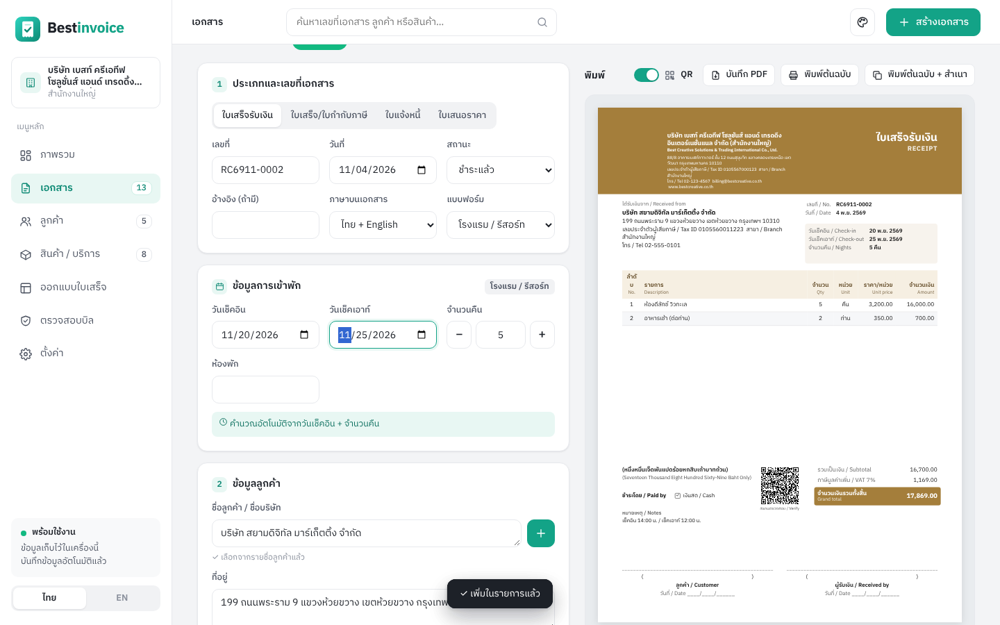

# Bestinvoice 1.3

<p align="center"></p>

**Bestinvoice** — Thai / English receipt, tax invoice, invoice and quotation maker. Runs on **Windows**, **macOS**, or in any browser, fully offline. Drag-and-drop receipt designer, business templates (hotel check-in/out, restaurant slip, clinic, car service…), 6 paper sizes with auto layout, signed QR bill verification, 5 color themes.

| ออกบิลโรงแรม (เช็คอิน/เช็คเอาท์อัตโนมัติ) | ออกแบบใบเสร็จแบบลากวาง |
|---|---|
|  |  |
| **ตรวจสอบบิลด้วย QR** | **ธีมสี 5 แบบ** |
|  |  |

โปรแกรมออกใบเสร็จรับเงิน ใบกำกับภาษี ใบแจ้งหนี้ และใบเสนอราคา — ภาษาไทย / English — ใช้ได้ทั้ง Windows และ Mac

## เริ่มใช้งาน

| เครื่อง | วิธีเปิด |
|---|---|
| **Windows** | ดับเบิลคลิก `Bestinvoice-Portable-1.3.0.exe` (ไฟล์เดียว) หรือเปิดโฟลเดอร์ `Windows` แล้วดับเบิลคลิก `Bestinvoice.exe` |
| **Mac (M1/M2/M3/M4)** | คัดลอก `Bestinvoice-1.3.0-macOS-AppleSilicon.zip` ไปที่ Mac แล้วดับเบิลคลิกเพื่อแตกไฟล์ ลาก `Bestinvoice.app` ไปไว้ใน Applications |
| **Mac (Intel)** | ใช้ไฟล์ `Bestinvoice-1.3.0-macOS-Intel.zip` แบบเดียวกัน |
| **เครื่องไหนก็ได้** | ดับเบิลคลิก `Bestinvoice.html` เปิดในเบราว์เซอร์ Chrome / Edge / Safari ได้เลย ไม่ต้องติดตั้ง ใช้งานแบบออฟไลน์ |

**Mac ครั้งแรก:** เพราะโปรแกรมยังไม่ได้ลงทะเบียนกับ Apple ให้ *คลิกขวา › Open › Open*
ถ้ายังเปิดไม่ได้: System Settings › Privacy & Security › เลื่อนลงกด **Open Anyway**

**Windows ครั้งแรก:** ถ้าขึ้นหน้าต่าง SmartScreen สีฟ้า ให้กด *More info › Run anyway*

## ความสามารถ
- ใบเสร็จรับเงิน, ใบเสร็จ/ใบกำกับภาษี, ใบแจ้งหนี้, ใบเสนอราคา และสร้างต่อจากกันได้ (เช่น ใบเสนอราคา → ใบแจ้งหนี้ → ใบเสร็จ)
- ชื่อบริษัท/ชื่อลูกค้ายาวได้ไม่จำกัด ตัดบรรทัดและย่อตัวอักษรให้พอดีกรอบอัตโนมัติ
- VAT (แยก/รวม/ไม่มี), หัก ณ ที่จ่าย 1–5%, ส่วนลดรายการและท้ายบิล
- จำนวนเงินเป็นตัวอักษรไทย (ใช้ baht.js) และภาษาอังกฤษ
- เอกสารพิมพ์ได้เป็นภาษาไทย อังกฤษ หรือสองภาษา, ปี พ.ศ./ค.ศ., พิมพ์ต้นฉบับ + สำเนา
- **ออกแบบใบเสร็จแบบลากวาง**: ลากกล่องข้อมูลไปวาง ปรับขนาด สี ฟอนต์ ซ่อน/แสดง ย้อนกลับได้ ชื่อทุกช่องเป็นภาษาที่อ่านแล้วเข้าใจทันที เช่น {ชื่อลูกค้า} {ยอดรวมทั้งสิ้น}
- แบบฟอร์มสำเร็จรูป: มินิมอล, คลาสสิก, โมเดิร์น, A5, สลิป 80 มม.
- รายการเยอะเกินหน้า → แบ่งหน้าอัตโนมัติ พร้อมเลขหน้า
- ข้อมูลเก็บในเครื่อง, ดาวน์โหลด/นำเข้าไฟล์สำรองได้ (ย้ายข้าม Mac/Windows ได้), เวอร์ชันเดสก์ท็อปสำรองอัตโนมัติทุกวัน (เมนู File › Open backup folder)

## ใหม่ในเวอร์ชัน 1.3
- **โรงแรม: คิดเงิน ราคาห้อง × จำนวนห้อง × จำนวนคืน** (เช่น 500 × 1 ห้อง × 2 คืน = 1,000 / 500 × 2 ห้อง × 3 คืน = 3,000) — เพิ่มช่อง “จำนวนห้อง” และคอลัมน์ “คืน” ในตาราง; เปลี่ยนจำนวนคืน/ห้อง/วันเช็คเอาท์ ยอดอัปเดตทันที (สินค้าที่หน่วยมีคำว่า “คืน” เช่น “ห้อง/คืน” จะคิดแบบนี้อัตโนมัติ)
- **เลือกฟอนต์ได้ 7 แบบ**: IBM Plex Sans Thai, Sarabun, Kanit, Bai Jamjuree, Noto Sans Thai, Noto Sans Thai Looped, Google Sans — ตั้งได้ทั้งแบบฟอร์ม, รายกล่อง และฟอนต์ของโปรแกรม
- **หน้าใบเสร็จมาตรฐานขึ้น**: คำอ่านจำนวนเงินภาษาไทยอยู่แถวเดียวกับ “จำนวนเงินรวมทั้งสิ้น”, หมายเหตุ/วิธีชำระเงินวางต่อด้านล่าง, คอลัมน์ “ลำดับ” ไม่เบียดแล้ว
- แก้: หน้าออกแบบใบเสร็จแสดงข้อมูลตัวอย่างไม่ได้ (เวอร์ชัน 1.2) — ตอนนี้ดูตัวอย่างได้ รวมถึงข้อมูลเข้าพักของแบบฟอร์มโรงแรม

## ใหม่ในเวอร์ชัน 1.2
- **QR ตรวจสอบบิล**: สแกนด้วยมือถือจะขึ้น “✅ บิลเลขที่ … ผ่านการตรวจสอบ” พร้อมยอดเงิน
  - ตรวจของจริงได้ที่เมนู **ตรวจสอบบิล** (สแกนด้วยกล้อง / เลือกรูป / เครื่องสแกน) ระบบเช็กรหัสลับของบริษัทคุณ — ถ้าบิลปลอมหรือยอดถูกแก้จะขึ้นว่าไม่ผ่าน, บิลที่ยกเลิกแล้วจะเตือน
  - **เปิด/ปิดได้**: หน้าตั้งค่า (ค่าเริ่มต้นทุกบิล) · สวิตช์ “QR” ในหน้าออกเอกสาร (เฉพาะบิลนั้น) · หน้าออกแบบ (ซ่อนในแบบฟอร์มนั้น)
  - รหัสลับเก็บอยู่ในไฟล์สำรองข้อมูล — เครื่องที่นำเข้าไฟล์สำรองเดียวกันจะตรวจบิลกันได้
- แบบฟอร์มโรงแรม: ตัดช่อง “จำนวนผู้เข้าพัก” ออก (เหลือ เช็คอิน · เช็คเอาท์ · จำนวนคืน · ห้องพัก)

## ใหม่ในเวอร์ชัน 1.1
- ช่องลูกค้า: พิมพ์แล้วขึ้นรายชื่อให้เลือกทันที (ค้นจากชื่อ เลขผู้เสียภาษี เบอร์โทร) ใช้ลูกศร ↑↓ + Enter ได้ / ปุ่ม **+** เพิ่มลูกค้าใหม่
- สินค้าเป็น tag: คลิกแล้วเข้าไปในรายการทันที คลิกซ้ำ = เพิ่มจำนวน มีปุ่ม “+ สินค้าใหม่”
- ธีมสีโปรแกรม 5 แบบ: มินิมอล พาสเทล โมเดิร์น คลาสสิก กระจก (Glass) — ปุ่มจานสีมุมขวาบน หรือหน้าตั้งค่า
- กระดาษ 6 แบบ: A4 แนวตั้ง/แนวนอน, A5 แนวตั้ง/แนวนอน, สลิป 80 มม. แนวตั้ง, สลิปแนวนอน 210×99 — เปลี่ยนแล้วจัด layout ให้อัตโนมัติ
- แบบฟอร์มตามธุรกิจ: โรงแรม/รีสอร์ท, ร้านอาหาร/คาเฟ่, ร้านค้าปลีก, บริการ/เอเจนซี่, คลินิก, อู่ซ่อมรถ, โรงเรียน/กวดวิชา, ให้เช่า/อพาร์ตเมนต์
- โรงแรม: วันเช็คอิน + จำนวนคืน → วันเช็คเอาท์คำนวณให้อัตโนมัติ (แก้วันเช็คเอาท์ → จำนวนคืนเปลี่ยนตาม) และรายการที่หน่วยเป็น “คืน” จะปรับจำนวนตามให้เอง
- เพิ่ม/แก้ช่องข้อมูลหัวบิลเองได้ในหน้าออกแบบ (เช่น เลขโต๊ะ ทะเบียนรถ HN)

## สำหรับนักพัฒนา (Build from source)
```
src/             โค้ดโปรแกรม (HTML/CSS/JS ล้วน ไม่ใช้ framework)
build.js         รวมทุกอย่าง (รวมฟอนต์และไลบรารี) เป็นไฟล์เดียว dist/Bestinvoice.html
fonts/           ฟอนต์เอกสาร (ตัดเหลือไทย+อังกฤษ, woff2) + ไฟล์สัญญาอนุญาต OFL
electron/        ตัวห่อแอปเดสก์ท็อป (main.js, preload.js, ไอคอน)
scripts/         สคริปต์แพ็กแอป Windows / macOS

npm install
npm run build                      # → dist/Bestinvoice.html (เปิดในเบราว์เซอร์ได้เลย)
npm run app                        # คัดลอกไปเป็น electron/app/index.html
cd electron && npm install && npx electron .            # ทดลองรันแอปเดสก์ท็อป
cd electron && npm run build:win   # (บน Windows) ตัวติดตั้ง + portable .exe
cd electron && npm run build:mac   # (บน Mac) .dmg
```
ข้อมูลทั้งหมดเก็บในเครื่องผู้ใช้ (localStorage / โฟลเดอร์ userData ของแอป) ไม่มีการส่งข้อมูลออกนอกเครื่อง

**Third-party:** baht.js © Manassarn Manoonchai (MIT) · qrcode-generator © Kazuhiko Arase (MIT) · jsQR © Cozmo (Apache-2.0) · Electron (MIT)  
Fonts: IBM Plex Sans Thai, Sarabun, Kanit, Bai Jamjuree, Noto Sans Thai, Noto Sans Thai Looped, Google Sans — SIL Open Font License 1.1 (see `fonts/licenses/`)
